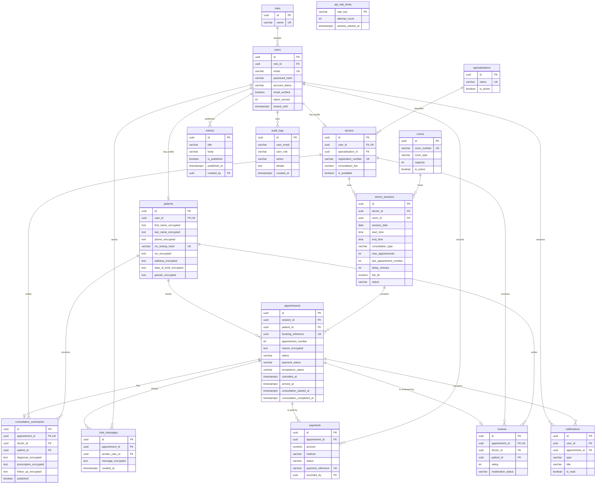

# MediChannel database design

MediChannel uses PostgreSQL 18 with Flyway migrations `V1`–`V15`. The
canonical DDL is checked in as [`schema.sql`](./schema.sql), generated with
`pg_dump --schema-only` from a database that has all migrations applied.

## Entity–relationship diagram

## Constraints and indexes

- Primary keys are UUIDs generated by `gen_random_uuid()`.
- Foreign keys use `ON DELETE RESTRICT` for clinical records and
  `ON DELETE CASCADE` only for notifications owned by a user.
- `appointments` has a unique `booking_reference` and a unique
  `(session_id, appointment_number)` pair.
- At most one completed payment exists per appointment (partial unique
  index `uq_completed_payment_per_appointment`).
- A patient may review an appointment only once (`uq_review_appointment`).
- One consultation summary exists per appointment (`uq_summary_appointment`).
- Check constraints enforce status enums, non-negative fees, rating
  `BETWEEN 1 AND 5`, password-length-independent data lengths and the
  publish/read-state invariants for notices and notifications.
- Indexes cover queue lookups (`session_id`, `appointment_number`),
  session discovery (`session_date`, `status`), notification unread
  counts, review averages and audit-log recency.

## Encryption at rest

Patient names, phone, date of birth, gender, address and NIC, appointment
reasons, consultation summaries and chat messages are stored as AES-256-GCM
ciphertext (`v1:` prefix). NIC lookup uses a separate HMAC-SHA-256 hash so
duplicate detection does not require decryption. Passwords are BCrypt
(work factor 12). The only remaining plaintext personal identifier is the
login email on `users.email`, which must stay queryable for authentication.
